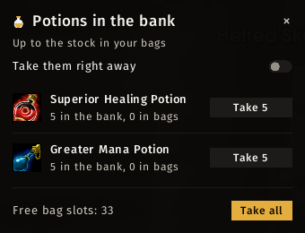

# RePotion: Potion Tracker & Restock

Keeps your health, mana and Free Action Potions in one place in WoW Forever: one button per potion type that drinks the strongest potion you have, a key and an action bar macro that do the same, and panels that restock potions at the auction house and the bank.

## The panel

A small panel with a health potion button and, for classes with mana, a mana potion button. Free Action Potions are off by default: switch them on on the Potions tab to get a third button. Each button shows the potion it will drink, the shared potion cooldown and how many potions you keep (amber below your stock, red at 0).

A click drinks the strongest potion in your bags that your level allows. Hover a button for the potion's tooltip, with your stock and the potions in your bags added under it.

The count is your stock: the potion you buy and stronger ones. By default that is the strongest potion sold for your level. With 2 Major and 3 Superior Healing Potions the button shows 2 in amber, and the auction house offers 3 Major. Weaker potions don't count, but they are drunk when nothing stronger is left.

In combat the buttons keep the choice they had when the fight started, because the game doesn't let addons change them mid-fight. If you start a fight with your last Major Healing Potion, the button falls back to the next potion once it's gone.

The panel shows always (the default), only in combat, or never. Drag the title line above the buttons or Alt-drag a button to move the panel, middle-click to put it back, right-click for the settings. The title line can be turned off.

## Keys and macros

- Bind a key to each potion type on the Potions tab or in the game's key bindings.
- Shift-drag a button from the panel onto an action bar and you get a macro (RePotion Health, RePotion Mana, RePotion Action) that follows every choice the addon makes and shows the potion, its count and cooldown like a normal action button. The Potions tab has a **Pick up** button for each of these macros.

The macros are made per character when you first take them. If all 30 character macro slots are taken, an account macro is used.

## Auction house

When you open the auction house, a panel next to it lists the potions you are short of, up to the stock you keep (5 of each potion type by default, adjustable). Potions in the bank count toward it; switch off "Count potions in the bank" on the panel or on the Auction tab to buy the full stock for your bags. The panel looks up a price only when it has none: when you press **Find price** on a row or **Find all prices** under the list, or pick a variant without a price, so opening the auction house to sell things doesn't slow it down. If you have Auctionator, a row shows its price with ≈ and **Buy** works without a search: the purchase goes through when the total is at most 20% (the price jump guard, adjustable) above that price, otherwise the row shows the real total and waits for **Confirm**. Prices it found stay until you close the auction house: buying, picking another variant or a change in your bags is counted from them without a new search. **Refresh** looks every price on the panel up again, right-click a variant to look up only its price, right-click a row for all its variants. A search you make yourself, in Auctionator or the auction house window, also fills in the row.

- The strongest potion on sale is chosen by default. Under each row every potion you can use is listed with how much it restores and its price per potion; click another one to buy it instead. Your pick is remembered, and the stock then counts that potion and stronger ones: with Superior picked, 2 Major and 3 Superior are 5 of 5 and the row says **Enough**. Click the top potion to go back to the strongest.
- Potions that restore less than 20% of your max health or mana (adjustable per type) aren't listed. A level 60 warrior with 4000 health sees Superior and Major Healing Potions, not Healing Potions.
- The **Price jump guard** takes only potions priced at most 20% (adjustable) above the cheapest one. If 4 potions cost 15s and the fifth costs 1g, the panel buys 4 and tells you the rest is dearer.
- **Buy N** buys that potion. If the price went up since the lookup, the row asks you to confirm the new price.

## Bank

When you open the bank, a panel next to it lists the potions your bags are short of. **Take all** moves the potions the stock counts into your bags, the strongest first, splitting stacks so you get exactly the stock. Turn on "Take when the bank opens" to skip the click.

Both panels sit to the right of their window and follow it, also when a bag addon replaces the bank window. They share the space with the panels of the other Re addons. On the Auction and Bank tabs you can attach the panel to the window or to another addon's panel, to the right, left, below or above. Drag a panel to move it; right-click it to open or close its settings, middle-click to put it back.

## Settings

`/potions` (or `/repotion`) opens the settings:

- The Potions tab has a block per potion type with the potion it drinks, a switch for this character, how many to keep, the skip threshold, the key and the macro.
- The Panel tab sets when the panel shows up, potions you are out of, icon size, spacing, row or column, the title line, the count, the lock and the background of the panel and of the auction and bank panels.
- The Auction tab turns the auction house list on or off and sets counting the bank, the price jump guard and where the panel sits.
- The Bank tab turns the bank panel on or off and sets taking potions when the bank opens and where the panel sits.
- The General tab has the panel switch, the minimap button and the language.

## Other Re addons

Panels like this one for the other things you carry:

- [ReScroll](https://www.curseforge.com/projects/1812247) shows which scroll buffs you are missing, applies them with one button and restocks scrolls at the auction house and the bank ([GitHub](https://github.com/Jagerente/ReScroll)).
- [ReFood](https://www.curseforge.com/projects/1816338) eats and drinks the strongest food you carry, reminds you of Well Fed and restocks food at the vendor, the auction house and the bank ([GitHub](https://github.com/Jagerente/ReFood)).
- [ReReagent](https://www.curseforge.com/projects/1816458) counts the reagents your class spells use and restocks them at the vendor and the bank ([GitHub](https://github.com/Jagerente/ReReagent)).
- [ReWeapon](https://www.curseforge.com/projects/1816469) puts sharpening stones, oils and poisons on your weapons with one button per hand and restocks them at the vendor, the auction house and the bank ([GitHub](https://github.com/Jagerente/ReWeapon)).
