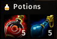
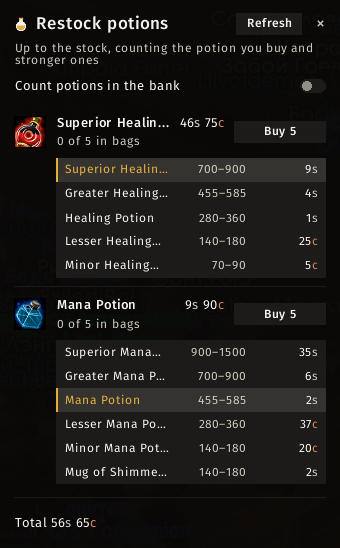

# RePotion: Potion Tracker & Restock

Keeps your health and mana potions in one place in WoW Forever: one button per potion type that drinks the strongest potion you have, a key and an action bar macro that do the same, and panels that restock potions from the auction house and the bank.

## The panel

A small panel with a health potion button and, for classes with mana, a mana potion button. Each button shows the potion it will drink, the shared potion cooldown and how many potions you keep (amber below your stock, red at 0).

A click drinks the strongest potion in your bags that your level allows. Hover a button for the full list of potions in your bags.

The count is your stock: the potion you buy and stronger ones. By default that is the strongest potion sold for your level. With 2 Major and 3 Superior Healing Potions the button shows 2 in amber, and the auction house offers 3 Major. Weaker potions don't count, but they are drunk when nothing stronger is left.

In combat the buttons keep the choice they had when the fight started, because the game doesn't let addons change them mid-fight. If you start a fight with your last Major Healing Potion, the button falls back to the next potion once it's gone.

The panel shows always (the default), only in combat, or never. Drag the title line above the buttons or Alt-drag a button to move the panel, middle-click to put it back, right-click for the settings. The title line can be turned off.

## Keys and macros

- Bind a key to each potion type on the General tab or in the game's key bindings.
- Drag a button from the panel onto an action bar and you get a macro (RePotion Health, RePotion Mana) that follows every choice the addon makes and shows the potion, its count and cooldown like a normal action button. The Potions tab has buttons that pick up the same macros.

The macros are made per character when you first drag them. If all 30 character macro slots are taken, an account macro is used.

## Auction house

When you open the auction house, a panel next to it lists the potions you are short of, up to the stock you keep (5 health and 5 mana potions by default, adjustable). Potions in the bank count toward it; switch off "Count potions in the bank" right in the panel to buy the full stock for your bags.

- The strongest potion on sale is chosen by default. Under each row every potion you can use is listed with how much it restores and its price per potion; click another one to buy it instead. Your pick is remembered, and the stock then counts that potion and stronger ones: with Superior picked, 2 Major and 3 Superior are 5 of 5 and the row says **Enough**. Click the top potion to go back to the strongest.
- Potions that restore less than 20% of your max health or mana (adjustable per type) aren't listed. A level 60 warrior with 4000 health sees Superior and Major Healing Potions, not Healing Potions.
- **Price jump guard.** A purchase takes only potions priced at most 20% (adjustable) above the cheapest one. If 4 potions cost 15s and the fifth costs 1g, the panel buys 4 and tells you the rest is dearer.
- **Buy N** buys that potion in one click. If the price went up since the lookup, the row asks you to confirm the new price.

## Bank

When you open the bank, a panel next to it lists the potions your bags are short of. **Take all** moves the potions the stock counts into your bags, the strongest first, splitting stacks so you get exactly the stock. Turn on "Take them right away" to skip the click.

Both panels sit to the right of their window and follow it, also when a bag addon replaces the bank window. On the Auction and Bank tabs you can put the panel to the right, left, below or above the window. Drag a panel to move it; right-click it to open its settings, middle-click to put it back.

## Settings

`/potions` (or `/repotion`) opens the settings:

- **Potions:** which types to track on this character, the skip threshold, how many potions to keep, the macros
- **Panel:** when it shows up, potions you are out of, icon size, spacing, row or column, the title line, the count, lock
- **Auction:** the auction house list, counting the bank, the price jump guard, where the panel sits
- **Bank:** the bank panel, taking potions right away, where the panel sits
- **General:** the potion keys, minimap button, language

## Other Re addons

Panels like this one for the other things you carry, with the same restock at the auction house and the bank:

- [ReScroll](https://www.curseforge.com/projects/1812247) shows which scroll buffs you are missing, applies them with one button and restocks scrolls ([GitHub](https://github.com/Jagerente/ReScroll)).
- [ReFood](https://www.curseforge.com/projects/1816338) eats and drinks the strongest food you carry, reminds you of Well Fed and restocks food at the vendor ([GitHub](https://github.com/Jagerente/ReFood)).
